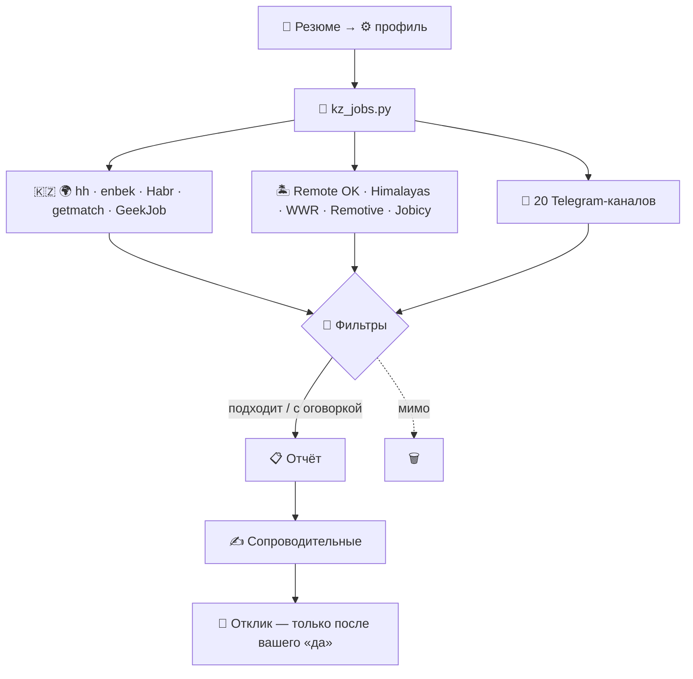

<div align="center">

# 🇰🇿 KZ Job Hunter

**Скилл для Claude, который каждый день ищет вам работу в Казахстане, СНГ и на удалёнке.**

Собирает вакансии с 12 площадок и 20 Telegram-каналов, отсеивает лишнее,
считает зарплату в тенге на руки и пишет сопроводительные письма.
Без логинов, API-ключей и сторонних зависимостей.


[Возможности](#-возможности) · [Быстрый старт](#-быстрый-старт) · [Источники](#-источники) · [Профиль](#%EF%B8%8F-профиль) · [CLI](#-cli)

</div>

---

## ✨ Возможности

<table>
<tr>
<td width="50%" valign="top">

### 🔎 Ищет везде сразу
hh.kz, enbek.kz, удалёнка со всех сайтов HH, Habr Career, getmatch, GeekJob,
Remote OK, Himalayas, We Work Remotely и ещё три remote-борда. Плюс 20 Telegram-каналов,
которые читаются **без входа в Telegram**.

</td>
<td width="50%" valign="top">

### 🧹 Отсеивает шум
Проверяет **полный текст** вакансии, а не только название: стек, уровень, формат работы.
Убирает «удалёнку только для РФ», рекламу курсов и одну и ту же вакансию,
размноженную по городам и каналам.

</td>
</tr>
<tr>
<td valign="top">

### 💸 Считает в тенге на руки
Рубли, доллары и евро переводятся в ₸, «до вычетов» пересчитывается в «на руки».
Порог зарплаты сравнивается с тем, что вы реально получите.

</td>
<td valign="top">

### 🏷️ Помечает, а не прячет
Нужен казахский, английский выше вашего уровня, тестовое задание,
наём только из Европы, только граждане РК — такие вакансии попадают в отдельную секцию.
Решаете вы.

</td>
</tr>
<tr>
<td valign="top">

### ✍️ Пишет сопроводительные
Письмо из пяти частей на языке вакансии: русском, казахском или английском.
Только факты из вашего резюме, без зарплаты и без воды.

</td>
<td valign="top">

### 🛡️ Ничего не делает за вашей спиной
Откликается только после явного «да» на конкретный список.
Пароли не спрашивает, капчи не обходит, паузы между запросами не убирает.

</td>
</tr>
</table>

---

## 🚀 Быстрый старт

**1. Установите скилл**

```bash
git clone https://github.com/adaskhan/kz-job-hunter-skill.git ~/.claude/skills/kz-job-hunter
```

**2. Попросите Claude**

> Вот моё резюме, найди мне работу — ищу удалёнку или СНГ

Скилл задаст несколько вопросов (город, формат, зарплата, языки), соберёт профиль
и запустит первый поиск. Дальше достаточно сказать **«запусти поиск»**.

**3. Обновляйтесь**

```bash
git -C ~/.claude/skills/kz-job-hunter pull
```

---

## 🧭 Как это работает



Скрипт собирает и фильтрует вакансии, Claude отвечает за всё, где нужна голова:
разбирает резюме, проверяет площадки с логином (LinkedIn, hirify), пишет письма
и откликается.

---

## 🌐 Источники

| | Площадки | Как |
|---|---|---|
| 🇰🇿 **Казахстан** | hh.kz · enbek.kz | скрипт |
| 🌍 **СНГ** | удалёнка hh.ru (все страны HH) · Habr Career · getmatch · GeekJob | скрипт |
| 🏝️ **Удалёнка** | Remote OK · Himalayas · We Work Remotely · Working Nomads · Remotive · Jobicy | скрипт |
| 💬 **Telegram** | @devkz_jobs · @workitkz · @jobkz_1 · @devkg · @job_python и ещё 15 | скрипт |
| 💼 **LinkedIn** | вакансии · посты HR с `#hiring` `#вакансия` · страницы компаний | браузер |
| 🏢 **Компании** | карьерные страницы из вашего списка | браузер |
| 🔐 **С логином** | hirify · jobtoo · talent-move · ArbiHunter · aijobs · группа @cyprusithr | браузер |

Полный список с подписчиками, эндпоинтами и нюансами каждой площадки —
в [`references/platforms.md`](references/platforms.md).

---

## ⚙️ Профиль

Все предпочтения хранятся в `~/.kz-job-hunter/profile.json`. Код трогать не нужно:
скилл подходит под любую профессию.

```jsonc
{
  "keywords": ["python", "django", "fastapi", "backend", "бэкенд"],
  "title_must_match": "python|django|fastapi|back-?end|бэкенд",
  "require_in_text": "python|django|fastapi",       // в описании должен быть ваш стек
  "exclude_title": ["junior", "стаж[её]р", "\\bqa\\b"],

  "hh_sites": [
    { "domain": "hh.kz", "areas": [160], "work_formats": ["REMOTE", "HYBRID"] },  // Алматы
    { "domain": "hh.ru", "areas": [],    "work_formats": ["REMOTE"] }             // вся удалёнка HH
  ],

  "salary_min_kzt_net": 700000,   // порог на руки, ₸
  "english_level": "b2",
  "kazakh_level": "b1",
  "tg_channels": ["devkz_jobs", "workitkz", "job_python"]
}
```

Полный пример со всеми полями — [`profile.example.json`](profile.example.json).
Коды регионов, налоги и типичные формулировки в вакансиях —
[`references/kz-specifics.md`](references/kz-specifics.md).

---

## 💻 CLI

Скрипт работает и без Claude. Нужен только Python 3.10+.

```bash
# собрать вакансии (с описаниями — точнее фильтры)
python3 scripts/kz_jobs.py search --profile profile.example.json --out run.json --details

# только выбранные источники
python3 scripts/kz_jobs.py search --profile profile.example.json --sources hh,tg,habr

# поменяли профиль — перефильтровать собранное за секунды, без запросов к сайтам
python3 scripts/kz_jobs.py refilter --in run.json --profile profile.example.json

# отчёт в Markdown
python3 scripts/kz_jobs.py report --in run.json --out report.md

# запомнить показанное, чтобы завтра увидеть только новое
python3 scripts/kz_jobs.py mark-seen --in run.json --profile profile.example.json
```

<details>
<summary><b>Все источники для <code>--sources</code></b></summary>

| Ключ | Площадка |
|---|---|
| `hh` | hh.kz, hh.ru и другие сайты HH из `hh_sites` |
| `enbek` | enbek.kz |
| `tg` | Telegram-каналы из `tg_channels` |
| `habr` | Habr Career |
| `getmatch` | getmatch.ru |
| `geekjob` | geekjob.ru |
| `remoteok` | Remote OK |
| `himalayas` | Himalayas |
| `wwr` | We Work Remotely |
| `workingnomads` | Working Nomads |
| `remotive` | Remotive |
| `jobicy` | Jobicy |

</details>

<details>
<summary><b>Что проверяет фильтр</b></summary>

**Отсеивает**
- название не по профилю или из стоп-листа
- стек не тот: в описании или ключевых навыках нет ваших технологий
- удалёнка только для РФ/РБ: «удалённо из любого города России», «на территории РФ» и т.п.
- регион найма не ваш: «USA only», «EU only»
- формат работы не подходит или в тексте нет удалёнки
- зарплата ниже порога (вакансии без зарплаты остаются)
- реклама курсов, уже показанные вакансии, дубли

**Помечает**
- нужен казахский язык
- английский выше вашего уровня
- тестовое задание
- удалёнка с ограничением по стране
- только граждане РК (если вы иностранец)

</details>

---

## 📁 Структура

```
kz-job-hunter-skill/
├── SKILL.md                  # инструкции для Claude: онбординг, поиск, отклики
├── profile.example.json      # шаблон профиля
├── scripts/
│   └── kz_jobs.py            # сборщик и фильтры, только stdlib
└── references/
    ├── platforms.md          # все источники и как с ними работать
    └── kz-specifics.md       # регионы, налоги, языки, формулировки
```

Ваши данные лежат отдельно, в `~/.kz-job-hunter/`: профиль, резюме, история прогонов и откликов.
В репозиторий они не попадают.

---

## 🤝 Участие

Нашли живой Telegram-канал с вакансиями или площадку, которой здесь нет?
Откройте issue или пришлите PR в [`references/platforms.md`](references/platforms.md).

<div align="center">
<sub>Удачи на собеседованиях 🍀</sub>
</div>
